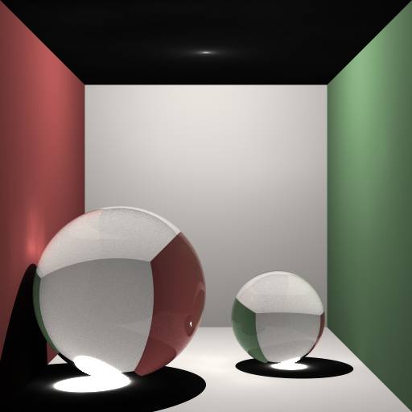
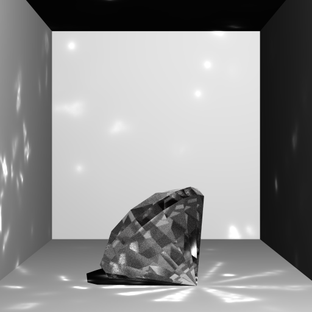
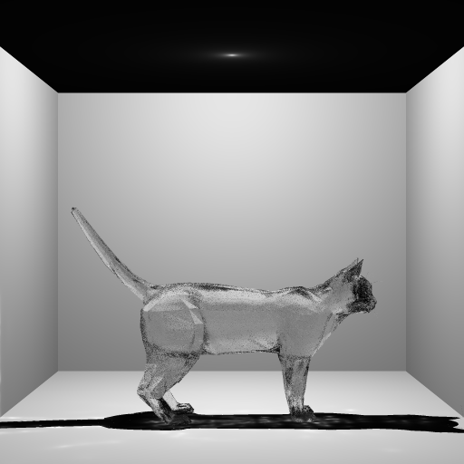

## About

An implementation of caustics for the 2026 RUG Computer Graphics contest (solo submission). The caustics are generated using photon mapping.

## Usage

Clone:
```sh
> git clone https://github.com/bdav65/CG-contest.git
```

Compile:
```sh
> cd CG-contest
> make
```

Run:
```sh
> ./ray_tracer <scene file>
```

The file `output.png` will contain the rendered image.

### Configuring

Parts of the photon mapping can be configured in the `"Caustics"` object in the scene files. The following fields are implemented:

 - `"PhotonCount"`, the amount of photons to simulate.
 - `"MaxBounces"`, how many times photons are allowed to reflect or refract.
 - `"MaxTries"`: since photons are cast naively, most don't create any caustics. This can be solved in a smart way, or you can just retry. This field controls how many times a photon can retry.

The *k* value of the k-nn photon search cannot be controlled from the scene files, since the shader needs a heap of that size, and (AFAIK) GLSL does not support dynamic arrays. If you really want to change it, redefine `K` in `src/shaders/raytracer.comp` and recompile.

## Showcase

Caustics created by two transparent spheres inside a Cornell box (`scenes/cornell.json`):



More complex caustics from a brilliant-cut diamond (`scenes/diamond.json`):



Caustics from the cat model (some caustics are visible in the shadow of the cat) (`scenes/cat.json`):


